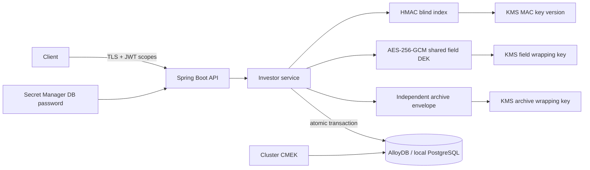

# Design and security boundaries

## Data flow

1. Validate and normalize identifiers: PAN trim/uppercase; Aadhaar strip spaces/hyphens, require 12 digits beginning 2–9. These are syntax checks, not identity verification or Aadhaar checksum/issuer verification. FATCA is a bounded opaque declaration string in this POC; production needs a versioned business schema and validation.
2. Generate an investor UUID. Compute `HMAC-SHA256("investor:v1:<field>:<canonical value>")` using a pinned KMS MAC key version. Neither identifiers nor keys are placed in URLs.
3. At startup, load the shared 256-bit field DEK from `investor.data_keys` via KMS. All PANs, Aadhaar values and name/FATCA profiles use that same DEK. Each encryption uses a fresh random 96-bit nonce and authenticates `investor:v1:<UUID>:<field>` as AAD. The wrapper uses stable purpose-bound AAD `investor:shared-dek:v1:field`.
4. Persist format 2, stable `dekId` and nonce+ciphertext+tag in each data envelope. No per-value DEK is generated or stored. The central key row stores its KEK resource, wrapped DEK, revision and update time. KMS ciphertext carries the wrapping-key version. Configured resources and expected DEK purpose are checked; stored resources cannot redirect KMS calls. Only this shared-DEK format is accepted; unsupported formats fail closed.
5. Serialize original input, encrypted fields and HMACs, then encrypt that archive using a separate shared archive DEK, wrapped by an independent KEK, and `archive` AAD. This protects the whole logical archive record, providing application-level protection analogous to the desired table boundary.
6. Insert both records in one PostgreSQL transaction. Archive failure rolls back the investor. Unique `(hmac_version, pan_hmac)` and `(hmac_version, aadhaar_hmac)` constraints resolve concurrent duplicate writes.
7. Exact lookup recomputes HMAC and uses the index; no decryption or table scan is necessary. PII retrieval requires its own authority and uses the cached field DEK.

The application holds plaintext transiently, so compromising its runtime identity can expose PII. Java strings cannot be reliably erased; shared DEKs remain cached for the process lifetime and are cleared on normal shutdown; per-operation key copies and plaintext byte arrays are cleared where practical. Neither SQL encryption nor CMEK eliminates the need to secure memory, debug dumps and workload identity.

## Key and privilege separation

| Resource | Type | Runtime permissions | Other principals |
|---|---|---|---|
| Field KEK | ENCRYPT_DECRYPT | encrypt/decrypt | Controlled rotation administrator |
| Blind index key | MAC / HMAC_SHA256 | macSign | Controlled index migration job |
| Archive KEK | ENCRYPT_DECRYPT | encrypt/decrypt for shared DEK startup | Authorized recovery team may decrypt |
| AlloyDB CMEK | ENCRYPT_DECRYPT | none | AlloyDB service agent encrypt/decrypt |
| Database password | Secret Manager version | accessor on this secret only | Credential rotation operator |

KMS keys are not exported to Secret Manager. Secret Manager stores the database password; key resource names are ordinary configuration. Production authentication uses attached workload identity/ADC; do not distribute service-account JSON keys. The local adapter is explicitly profile-gated and uses generated development keys in `.env`.

`investor_migrator` owns schemas and tables. `investor_app` can SELECT/INSERT investors, INSERT archive records, and SELECT/INSERT the HMAC-version safety latch; it cannot SELECT archive or UPDATE/DELETE investor/archive data. It can SELECT and UPDATE wrapper columns in `investor.data_keys`, but cannot INSERT/DELETE key identities. `pii_auditor` is a NOLOGIN database role with archive SELECT; grant membership only to individually attributable approved identities. Reading archive ciphertext also requires archive KMS decrypt permission. Shared archive DEK loading requires runtime archive decrypt permission. This reduces the previous KMS-level separation: a compromised runtime with access to archive ciphertext can decrypt it. SQL SELECT remains denied.

The local emulator does not model IAM and can decrypt both keys; the PostgreSQL tests enforce SQL grants. GCP IAM must allow archive decrypt for this shared-DEK design. Keep migration credentials out of the runtime deployment. DB owners/superusers bypass ordinary grants, but still need KMS access to decrypt the envelopes.

## Cleartext-table alternative

Literal SQL columns containing PAN/Aadhaar would be readable by anyone with SELECT, including privileged administrators. Cluster CMEK does not force a KMS call when SQL reads those values. Revoking a human's KMS access would not revoke that person's SQL plaintext access. Dumps, exports, CDC and query tooling could then propagate plaintext.

If SQL-readable plaintext is a firm requirement, use a separate dedicated vault service/database, narrowly scoped views, individual IAM/database identities and audited just-in-time access. A separate cluster permits independent storage CMEK; it still does not protect against authorized SQL reads. This POC intentionally implements encrypted original values in the archive, not a plaintext-column toggle. An authorized recovery tool must decrypt the archive in memory with the UUID-bound AAD and its own identity; no general-purpose archive-read endpoint is exposed.

## Rotation and recovery

**90-day encryption-key rotation:** configure a 90-day Cloud KMS automatic rotation schedule on each `ENCRYPT_DECRYPT` key: the PAN field KEK, archive KEK, and AlloyDB CMEK. The provision script does this with `--rotation-period=90d`. On day 90, KMS creates a new key *version* under the same logical key; the application configuration does not change and new DEKs are wrapped by the new primary version. Older wrapped DEKs remain decryptable while their versions remain enabled. KMS rotation does not re-encrypt existing encrypted DEKs or application ciphertext. Confirm whether your organization requires KEK rotation, DEK rotation, or both. If policy additionally requires all data to be protected by the newest version within 90 days, use the startup rewrap below and account for backups.

**Implemented startup rewrap:** set `UPDATE_DEK_ON_BOOT=true` after KMS has changed the primary version, then restart. Startup locks both seeded key rows in fixed order, unwraps their DEKs, re-encrypts the same DEKs using the current primary versions, verifies by decrypting the new wrappers, and updates both rows in one transaction. It publishes the cached keys only after commit. Lock waits are bounded at 15 seconds; a contending replica may fail startup and need retry. KMS/DB failures roll back and prevent startup. With the flag false, existing wrappers are only decrypted. First-time empty rows seeded by V2 are initialized regardless of this flag; missing rows and corrupt wrappers fail closed. Never reset initialized key rows to empty or delete/recreate the table: that would lose the keys protecting existing data.

The flag rewraps on every enabled boot; it does not detect rotation, create KEK versions, or schedule restarts. A service running past day 90 needs an explicit restart/rollout. Use KMS audit logs to confirm the actual primary version used. KEK versions must remain enabled throughout rewrap and verification. A different CryptoKey resource is not supported by this switch: keep the stable resource name for version rotation. PAN ciphertext and DEK bytes do not change, so already-running replicas continue to use the same DEKs safely.

**Backups:** startup rewrap updates only the shared-key table; investor and archive ciphertext remain unchanged. Retain old KEK versions while any backup, export or recovery copy of the key table needs them. Back up the key table with the data and test restore before disabling versions. This undeployed POC supports only shared-DEK envelopes; no compatibility reader or per-value DEK path is retained.

**Shared-key caveats:** compromise of one field DEK exposes all fields protected by it. KEK rewrap does not repair a compromised DEK or rotate that DEK; a separate data re-encryption migration would be needed. Cached keys mean disabling KMS access does not immediately revoke decryption in running processes. Stop those processes when revoking access, and protect heap dumps, debugging and swap. Random GCM nonces must never repeat under one DEK: set an aggregate encryption-volume limit across all replicas/fields and plan real DEK rotation before approaching the 2^32 invocation ceiling for random-IV GCM. This POC does not enforce a global usage counter; shared-key longevity must be reviewed against workload and policy. An example such as `abc` is explanatory only; actual keys are generated from a cryptographic RNG as 32 random bytes.

**90-day HMAC rotation:** treat this separately from encryption-key rotation. A new HMAC key version produces a different indexed value for the same PAN, so automatic switch-over would make existing PAN lookups fail. Schedule a controlled HMAC rotation before day 90: create a new HMAC key version, use a privileged migration identity to decrypt each PAN, calculate the new HMAC, update the primary record and encrypted archive in one transaction, check duplicate collisions and record counts, update the `crypto_policy` version latch, deploy the new `KMS_HMAC_VERSION`, then restart the service. Retain the old HMAC version until all retained backups and rollback windows that need it have expired. Never just change `KMS_HMAC_VERSION` in a live service.

For a production service that cannot have a maintenance window, evolve the schema to retain `pan_hmac_v1` and `pan_hmac_v2` (and corresponding Aadhaar columns), dual-write both indexes during the migration, read the new index first and the old index as a temporary fallback, backfill existing records, validate counts and uniqueness, then drop the old index only after the rollback/backup retention window. The current POC intentionally fails closed if the configured HMAC version differs from the recorded version, preventing accidental mixed-index operation.

**Secrets:** password is fetched once when the GCP connection pool is built. Rotate the database password and Secret Manager version using a coordinated rollout; update the pinned version and restart. There is no automatic hot refresh.

**Backup:** configure AlloyDB backups and continuous backup CMEK deliberately, retain application KMS versions for every retained backup, and test restore with the required identities. Losing a local `.env` or destroying required KMS versions makes data unrecoverable. Grant revocation and version disabling should be rehearsed before key destruction.

## Operational limits and production work

- Single organization, no owner/tenant scoping. For tenancy, derive tenant from authenticated claims, include it in indexes/AAD and enforce database/application row policy.
- Create/read/lookup only. Updates, deletion, retention, erasure, idempotency, history and rotation jobs need explicit requirements. Archive duplication increases the erasure and retention workload.
- HMAC reveals equality and frequency. PAN/Aadhaar have structured domains; access to macSign plus database indexes enables guessing. Restrict the signing identity, rate-limit lookup and creation, audit access and separate ingestion/read services if necessary. The POC has no rate limiter.
- Creates make two KMS MAC calls and no wrap calls; PII reveal uses cached keys without KMS. Startup unwraps two shared keys (and wraps/verifies both if provisioning or rewrapping). MAC calls occur inside the create transaction; benchmark latency, quotas, pool sizing and transaction duration before scale. Timeouts are bounded; failures fail closed, with no plaintext or local-key fallback. There are no automatic write retries.
- PII reveal emits an attempt and success audit record with actor/UUID; it does not expose PII. This is a starter audit trail, not a complete immutable audit system. Add denial/lookup/create actor events, correlation/reason codes, tamper-resistant retention and Cloud Audit Logs. Sanitize untrusted text. Never log bodies, HMACs, ciphertexts, secrets or provider error bodies.
- Require TLS ingress, private DB connectivity, verified DB TLS or the approved AlloyDB Auth Proxy, gateway request-size limits, JWT issuer/audience validation and scoped authorization. Do not expose local basic-auth mode. `/health` only checks process liveness; implement a separate readiness check.
- The ordinary archive role is read-only; row recovery/export is intentionally outside this runtime. A separate tool/service should enforce approval policy and log access.
- Perform threat modeling, dependency scanning and policy review before using real PAN/Aadhaar. The design makes no regulatory-compliance claim.

## Source references

- [AlloyDB CMEK](https://docs.cloud.google.com/alloydb/docs/cmek): storage encryption is configured on the cluster.
- [KMS envelope encryption](https://docs.cloud.google.com/kms/docs/envelope-encryption): locally used DEKs, centrally managed wrapping keys.
- [KMS MAC signatures](https://docs.cloud.google.com/kms/docs/mac-signatures) and [key algorithms](https://docs.cloud.google.com/kms/docs/algorithms): separate MAC-purpose key with HMAC_SHA256.
- [Secret Manager access](https://docs.cloud.google.com/secret-manager/docs/access-secret-version): version access with resource-scoped accessor permissions.
- [KMS data integrity](https://docs.cloud.google.com/kms/docs/data-integrity-guidelines): request/response CRC32C verification.

- [GCP re-encryption](https://docs.cloud.google.com/kms/docs/re-encrypt-data): decrypt with the original version and encrypt with the current primary.
- [NIST SP 800-38D](https://nvlpubs.nist.gov/nistpubs/Legacy/SP/nistspecialpublication800-38d.pdf), sections 8.2–8.3: nonce uniqueness and aggregate invocation limits.
